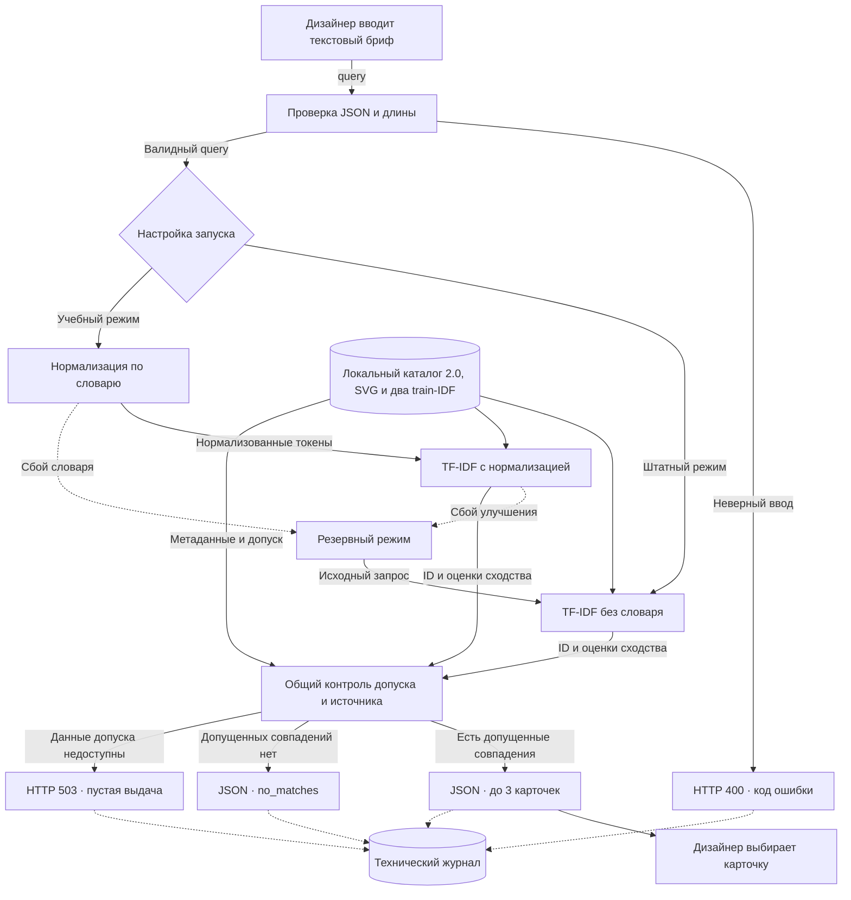
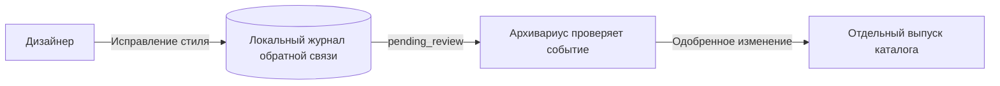

# Архитектура локального поиска афиш

Схема описывает alpha для следующего этапа проекта. Поиск реализуем на функциях ЛР 7 и 9. Интерфейс, HTTP-контракты и очередь исправлений ниже заданы как проектируемые компоненты.

## Контракты и ответственность

| Переход | Передаваемые поля и проверки |
|---|---|
| Дизайнер → валидатор | `POST /search` с JSON-объектом `{"query": "текст брифа"}`. После удаления внешних пробелов длина от 1 до 300 символов. Валидатор принимает строку и создаёт `request_id`. |
| Каталог → индексы и допуск | Версия, описание, `id`, `genre`, `style`, `source`, `rights_status`, локальный путь `image`. При запуске проверяются манифест и соответствие версий. Для каждого режима используется свой IDF, рассчитанный на одних и тех же карточках train. |
| Валидатор → режим → ранжирование | Переключатель режима задаёт оператор. Штатная ветка токенизирует исходный запрос. Учебная ветка заменяет токены по словарю 1.0 в запросе и описаниях. В обеих ветках нормированный TF-IDF сравнивается по косинусному сходству. |
| Ранжирование → контроль допуска | Кандидат несёт `id`, `score` и `matched_terms`. В индекс включаются карточки с допуском и непустым источником. Общий контроль сверяет эти поля по каталогу перед выбором top-3. Учитываются только положительные оценки, при равенстве порядок определяется по `id`. |
| Контроль → дизайнер | JSON содержит `request_id`, `status`, `mode`, `fallback_reason` и список `results`. Карточка содержит `id`, `genre`, `style`, `source`, `rights_status`, `image`, `score`, `matched_terms`. Изображение выдаётся по локальному ID после той же проверки допуска. Дизайнер сравнивает карточки и принимает окончательное решение. |
| Дизайнер → журнал → архивариус | Поступает `record_id`, `action=correct`, `actor`, `proposed_style`. После проверки входа добавляются `event_id`, время и `status=pending_review`. Архивариус решает, войдёт ли исправление в отдельную версию. Поиск и веса работают на прежней версии до её явной замены. |
| Ответ → технический журнал | Локальная запись хранит `request_id`, время, `mode`, `status`, `fallback_reason`, число результатов, длительность и версии данных и модели. Текст брифа исключён из журнала. |

## Ответы при сбое

| Сценарий | Ответ и следующий шаг |
|---|---|
| Строка пустая, превышает лимит, отсутствует или имеет другой тип | HTTP 400, `results=[]`. Коды `empty_query`, `query_too_long` или `invalid_query`. Для невалидного JSON используется `invalid_json`. Дизайнер исправляет запрос. |
| Словарь не загрузился, не прошёл проверку версии или отказало улучшение | Повторить поиск по исходной строке в baseline с тем же контролем прав. При совпадениях HTTP 200, `status=fallback`, `mode=baseline` и заполненный `fallback_reason`. Прямой запуск baseline при штатной настройке даёт `status=ok`. |
| Валидный запрос не дал допущенных совпадений | HTTP 200, `status=no_matches`, `results=[]`. Если запрос выполнялся в резервном режиме, `mode=baseline` и причина переключения сохраняются. Дизайнер меняет формулировку или открывает проверенные карточки каталога. |
| Базовый индекс или достоверные метаданные допуска недоступны | HTTP 503, `status=unavailable`, `results=[]`. Ручной просмотр возможен по отдельному проверенному снимку каталога, если его допуск актуален. При отсутствии такого снимка выдача блокируется до восстановления. |

Схема связывает R1 с поиском и top-3, R2 с источником в карточке, R3 с общим фильтром двух режимов и ручным решением, R4 с очередью исправлений, R5 с явными статусами. [Требования ЛР 3](https://github.com/Irina-64/ml-creative-technologies-course/tree/main/labs/03#артефакт-пять-историй-и-критерии)
