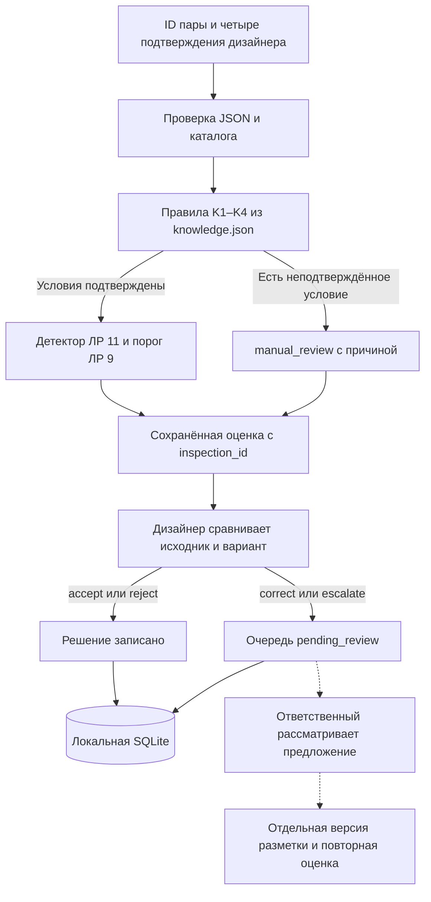

# Поток решения и контракт API

## Проверка пары

POST /inspect принимает объект с record_id и context. record_id соответствует pair_id из каталога ЛР 6. В context обязательны ровно четыре поля same_product, frontal_view, label_visible, regions_aligned типа boolean. Каждый запрос имеет Content-Type application/json, один Content-Length и тело до 4096 байт.

Ответ HTTP 200 содержит inspection_id, record_id, assessment, review_status, human_decision_required, knowledge_version, applied_rules, reasons, machine_result, provenance, feedback и release_allowed. При неподтверждённых условиях assessment=manual_review, machine_result=null и review_status=awaiting_expert. Иначе machine_result содержит фактическую оценку ЛР 11. Первоначальное состояние — awaiting_designer, release_allowed=false.

inspection_id определяется ID пары, контекстом, отпечатками картинок, версии знаний и решения модели. Повторный запрос с теми же входами получает ту же проверку вместе с уже записанным действием. Поле release_allowed означает только локальное решение дизайнера оставить этот кадр в данном учебном сценарии.

## Действие дизайнера

POST /feedback принимает event_id, inspection_id, actor=designer_demo, action и note. Для correct дополнительно обязательны proposed_label и defect_type. note после удаления внешних пробелов содержит от 1 до 500 символов. Идентификаторы содержат 1–80 латинских букв, цифр, символов подчёркивания или дефиса.

| action | Дополнительные поля | Статус события | Новое состояние проверки |
|---|---|---|---|
| accept | отсутствуют | recorded | designer_accepted, release_allowed=true |
| reject | отсутствуют | recorded | designer_rejected, release_allowed=false |
| correct | proposed_label=0 и none, либо proposed_label=1 и text/logo/shape | pending_review | awaiting_expert, release_allowed=false |
| escalate | отсутствуют | pending_review | awaiting_expert, release_allowed=false |

Для проверки с неподтверждёнными условиями разрешены correct и escalate. Принятие или отклонение требует подтверждённых условий. По каждой проверке сохраняется одно действие. Повтор того же event_id с теми же полями возвращает первоначальное событие. Повтор ID с другим содержимым или второе действие для уже решённой проверки возвращает 409.

Событие хранит поля запроса, record_id, время created_at в UTC, status, review_status и knowledge_version. model_updated и dataset_updated всегда false. В SQLite сохраняются снимок ответа без картинок, контекст и событие обратной связи. Запись события и изменение состояния выполняются в одной транзакции. Повторное открытие базы восстанавливает результат.

GET /inspections/{inspection_id} возвращает проверку с её текущим состоянием и действием. GET /feedback возвращает события по event_id. Доступ предназначен для локальной учебной сессии.

## Ошибки

| HTTP | Код или условие |
|---|---|
| 400 | object_required, invalid_record_id, context_requires_four_booleans, invalid_event_id, invalid_inspection_id, invalid_action, note_must_have_1_to_500_chars, invalid_label_and_defect_type, correction_fields_require_correct |
| 400, 413, 415 | Транспортные ошибки и лимиты унаследованы от HTTP-обработчика ЛР 11 |
| 403 | actor_not_allowed |
| 404 | record_not_found, inspection_not_found, not_found |
| 409 | expert_review_required, event_id_conflict, inspection_already_decided |
| 503 | image_integrity_failed, model_unavailable, resource_unavailable |

При несовпадении отпечатка файла знаний, каталога или базовых ресурсов запуск прекращается с диагностикой. При сбое чтения изображения или записи БД работающий сервер возвращает структурированную ошибку. Изображение и непроверенная пользовательская метка не подаются в переобучение.

[Фактические запросы и ответы](results/workflow_examples.json) · [Политика рассмотрения](review_policy.md)
